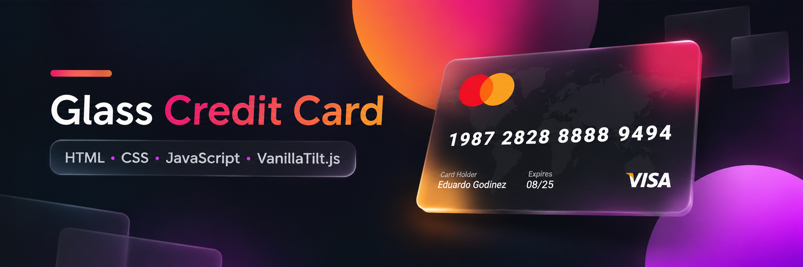

# 💳 Glass Credit Card

Diseño interactivo de una tarjeta de crédito con efecto **Glassmorphism**, desarrollado con HTML, CSS y JavaScript.

Este mini proyecto tiene como objetivo practicar estilos visuales modernos, efectos de transparencia y animaciones interactivas mediante la librería **VanillaTilt.js**.

### 🌐 Demostración en vivo

🚀 **[Ver proyecto en GitHub Pages](https://edgodinez.github.io/Glass-credit-card/)**

## ✨ Características

- 💎 Diseño Glassmorphism con efecto de cristal.
- 🎨 Estilos personalizados con CSS.
- 🖱️ Efecto de inclinación 3D al mover el cursor.
- ✨ Reflejos de luz y animaciones suaves.
- 💳 Simulación visual de una tarjeta bancaria.

## 🛠️ Tecnologías utilizadas

- **HTML5:** Estructura y contenido de la tarjeta.
- **CSS3:** Diseño, transparencias y efectos visuales.
- **JavaScript:** Configuración de la interactividad.
- **VanillaTilt.js:** Animación de inclinación 3D y reflejos.

## 🚀 Instalación y uso

1. Clona el repositorio:

```bash
git clone https://github.com/EdGodinez/Glass-credit-card.git
```

2. Accede al directorio:

```bash
cd Glass-credit-card
```

3. Abre el archivo `index.html` en tu navegador.

No requiere instalación de dependencias ni configuración adicional.

## 🎯 Objetivo del proyecto

Practicar la implementación de efectos visuales modernos en interfaces web, reforzando conocimientos de HTML, CSS y JavaScript, así como la integración de librerías externas para mejorar la experiencia del usuario.

## 👨‍💻 Autor

**Eduardo Godínez Santana**

- GitHub: [@EdGodinez](https://github.com/EdGodinez)

---

⭐ Proyecto desarrollado como ejercicio práctico de desarrollo frontend.